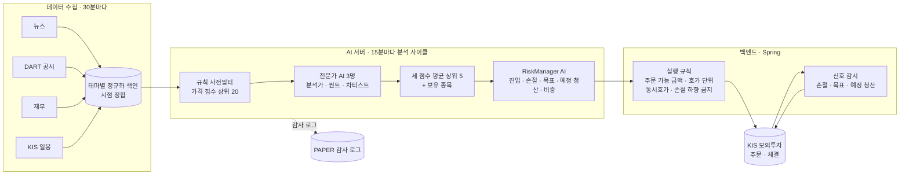
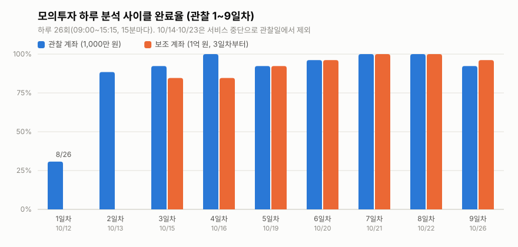
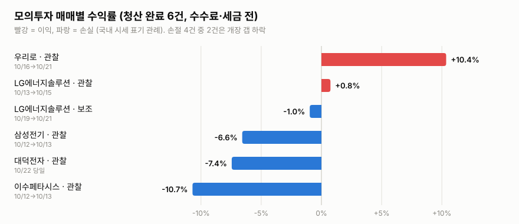
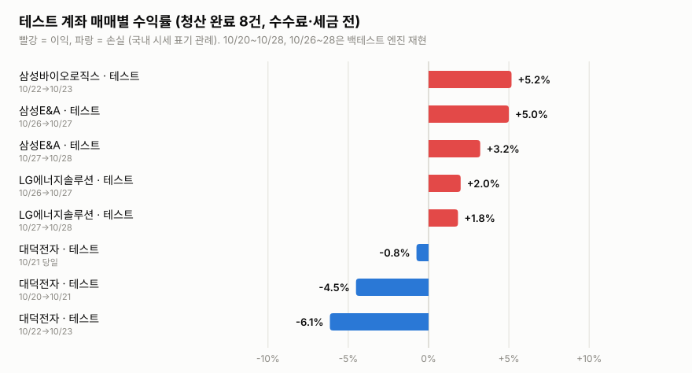
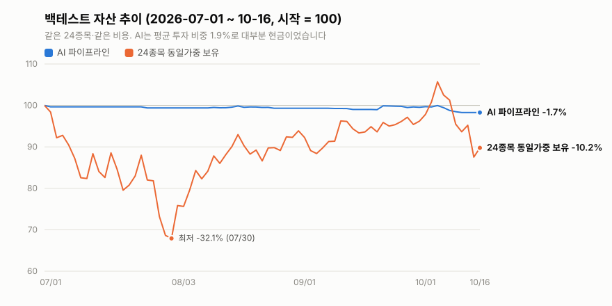
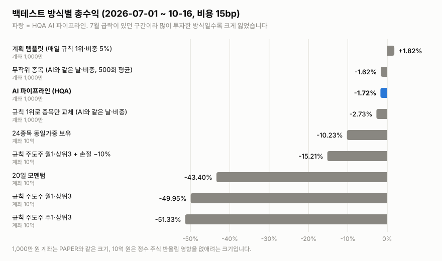
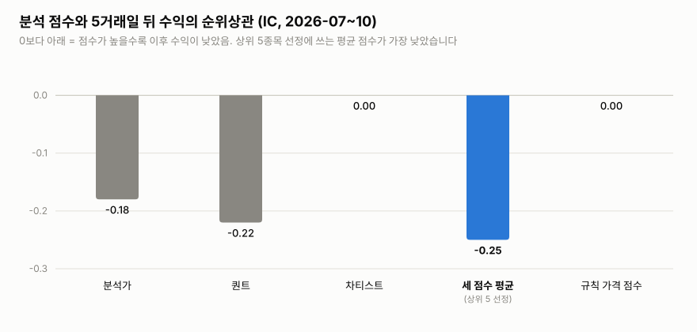

# HQA 졸업작품 포스터 자료

> **기준일: 2026-10-26.** 이날로 모의투자 관찰 20거래일 중 9일차를 마쳤습니다. 관찰은 2026-11-10에 끝나므로, 모의투자 숫자는 그 뒤 최종값으로 바꿔야 합니다. 백테스트는 끝났습니다(2026-10-22 작성, 10-25 정정).
>
> **출처.** 이 문서의 숫자는 PAPER 감사 로그, 백엔드 DB의 체결 기록, KIS 모의투자 계좌 조회, 백테스트 저장 결과에서 뽑았습니다. 원본 데이터, 계좌번호, 키는 저장소에 올리지 않습니다.
>
> **주의.** 이 문서는 측정한 결과만 적습니다. 앞으로의 수익을 예측하거나 투자를 권하지 않습니다.

## 0. 한눈에 보기 (포스터 핵심 숫자)

| 항목 | 값 |
|---|---|
| 무엇을 만들었나 | 테마 주도주 단기 매매를 위한 멀티 에이전트 AI 분석과 자동 모의투자 시스템 |
| AI 구성 | 전문가 3명(분석가·퀀트·차티스트)과 위험관리자(RiskManager). 모델은 Claude Opus 5.5 |
| 실전 검증 | 한국투자증권(KIS) 모의투자 계좌. 2026-10-12부터 20거래일, 하루 26회 분석 |
| 분석 사이클 완료 | 관찰 계좌 206/234회(88.0%). 첫날 수정 뒤 2~9일차는 198/208회(95.2%) |
| AI 호출 | 879회, 실패 0회 |
| 모의투자 매매 | 체결 12건, 청산 6건(이익 2, 손실 4) |
| 모의투자 평가금액 | 관찰 계좌 −1.81%, 보조 계좌 −0.06% (10/26) |
| 백테스트 | 2026-07-01~10-16(72거래일)에 실제 파이프라인을 시점 그대로 재현. AI 호출 1,054회 |
| 백테스트 수익 | AI −1.72%(최대낙폭 −1.72%). 같은 24종목 동일가중 보유는 −10.23%(최대낙폭 −32.08%) |
| 판정 | 운영 엔진으로는 **적합**. 매매 판단이 단순한 대안보다 낫다는 **근거는 없음** |

**포스터용 한 문장 요약**

- **문제:** 테마 주도주 단기 매매는 뉴스·공시·재무·차트를 매일 함께 봐야 해서, 사람이 일관되게 판단하기 어렵습니다.
- **방법:** 역할을 나눈 AI 에이전트가 근거를 읽고 매매 계획을 내면, 백엔드가 안전 규칙으로 걸러 증권사 모의투자에 주문합니다.
- **결과:** 실제 모의투자에서 하루 26회 분석을 안정적으로 운영했습니다(2일차 이후 사이클 완료 95%, AI 호출 실패 0). 72거래일 백테스트에서는 AI 판단의 우위가 확인되지 않았고, 개선할 지점(종목 순위, 손절폭, 보유 종목 재검토)을 수치로 찾았습니다.

## 1. 프로젝트 소개

- **배경.** 테마 주도주(2차전지, 5G, 자율주행차 등)는 뉴스와 공시에 빠르게 반응합니다. 그래서 정보를 모으고 판단하는 데 시간이 많이 들고, 판단 기준도 흔들리기 쉽습니다.
- **목표.**
  1. 데이터 수집부터 분석·계획·주문·감시까지 사람 개입 없이 도는 시스템을 만듭니다.
  2. AI 판단을 정해진 형식(진입가·손절가·목표가·예정 청산일·비중)의 계획으로 받고, 백엔드 규칙으로 안전하게 실행합니다.
  3. 실제 증권사 모의투자에서 20거래일 운영하고, 같은 파이프라인을 과거 구간에 재현하는 백테스트로 판단의 품질을 따로 잽니다.
- **원칙.**
  - 관찰 기간에는 모델·프롬프트·전략 설정을 바꾸지 않습니다. 운영 오류 수정만 허용합니다.
  - 모든 AI 요청과 응답, 사이클 결과를 감사 로그에 남깁니다.

## 2. 시스템 구조



- **수집:** 뉴스, DART 공시, 재무, KIS 일봉을 30분마다 모아 테마별 색인으로 정리합니다. 각 문서와 가격에는 언제 관측했는지가 붙습니다.
- **분석 사이클(09:00~15:15, 15분마다, 하루 26회):**
  1. 규칙 사전필터가 가격 점수로 후보 20개를 고릅니다.
  2. 전문가 AI 3명이 근거를 읽고 점수를 매깁니다.
  3. 세 점수의 평균 상위 5종목과 보유 종목을 RiskManager가 검토해 계획을 냅니다.
- **실행:** 백엔드는 계획을 그대로 주문하지 않습니다. 주문 가능 금액, KRX 호가 단위, 장 마감 동시호가 처리, "손절선은 올릴 수만 있다" 같은 규칙을 거칩니다.
- **감시:** 신호 감시가 보유 종목의 손절·목표·예정 청산을 계속 확인하고, 조건이 되면 청산 주문을 냅니다.

## 3. 기술 스택

| 영역 | 사용 기술 |
|---|---|
| AI 모델 | Claude Opus 5.5 (Claude Code CLI, 구독 요금제) |
| AI 서버 | Python 3.13, FastAPI·Uvicorn, LangChain Core, SQLite 감사 로그 |
| 백엔드 | Java 17, Spring Boot 3.5, PostgreSQL 16 |
| 증권사 연동 | 한국투자증권 KIS Open API (모의투자) |
| 프런트엔드 | Next.js 15, React 19 |
| 운영 | 서비스별 자동 재시작 감시 루프, macOS launchd(데이터베이스·잠자기 방지·로그인 시 자동 시작), 평일 3회 AI 정기 점검 |

## 4. 모의투자 운영 결과 (2026-10-12 ~ , 9/20일차 기준)

### 4.1 설정

| 항목 | 관찰 계좌 | 보조 계좌 |
|---|---|---|
| 계좌 | KIS 상시 모의투자 | 1억 원 모의계좌 (거래 가능 종목 제한 있음) |
| 시작 자금 | 10,000,000원 | 100,000,000원 |
| 운영 시작 | 2026-10-12 (1일차) | 2026-10-15 (3일차) |
| 분석 | 하루 26회 (09:00~15:15, 15분마다) | 같음 |
| 관찰 종료 | 2026-11-10. 20거래일, 서비스 중단일 10/14·10/23 제외 | 같음 |

### 4.2 일별 운영

| 일차 | 날짜 | 관찰 계좌 사이클 | 보조 계좌 사이클 | AI 호출(실패) | 체결 |
|---|---|---:|---:|---:|---|
| 1 | 10/12 | 8/26 | – | 65 (0) | 관찰 매수 2 (이수페타시스, 삼성전기) |
| 2 | 10/13 | 23/26 | – | 92 (0) | 관찰 손절 2, 매수 1 (LG에너지솔루션) |
| 3 | 10/15 | 24/26 | 22/26 | 107 (0) | 관찰 예정 청산 1 (LG에너지솔루션) |
| 4 | 10/16 | 26/26 | 22/26 | 74 (0) | 관찰 매수 1 (우리로) |
| 5 | 10/19 | 24/26 | 24/26 | 120 (0) | 보조 매수 1 (LG에너지솔루션) |
| 6 | 10/20 | 25/26 | 25/26 | 93 (0) | – |
| 7 | 10/21 | 26/26 | 26/26 | 117 (0) | 보조 손절 1, 관찰 예정 청산 1 (우리로) |
| 8 | 10/22 | 26/26 | 26/26 | 88 (0) | 관찰 매수 1, 손절 1 (대덕전자) |
| 9 | 10/26 | 24/26 | 25/26 | 123 (0) | – |
| **합계** | | **206/234 (88.0%)** | **170/182 (93.4%)** | **879 (0)** | 체결 12건, 청산 6건 |

- **1일차 8/26:** 첫날 KIS 대기열 때문에 AI 분석이 시간 초과로 끝났고, 당일 장중에 고쳤습니다(4.5 참고).
- **나머지 실패:** 대부분 KIS 모의투자 서버의 잔고 조회 오류(HTTP 500)였습니다. 재시도와 사이클 안 재조회를 넣어 줄였습니다.
- **AI 호출:** 879회 모두 응답을 받았습니다. 응답이 형식에 맞지 않거나 시간을 넘긴 실패는 0건입니다.



### 4.3 매매 내역 (청산 완료 6건)

| 계좌 | 종목 | 매수 | 매도 | 수익률* | 청산 사유 |
|---|---|---|---|---:|---|
| 관찰 | 이수페타시스 | 10/12, 127,800원 × 7 | 10/13, 114,114원 | −10.7% | 손절(개장 갭 하락) |
| 관찰 | 삼성전기 | 10/12, 1,520,000원 × 1 | 10/13, 1,420,000원 | −6.6% | 손절(개장 갭 하락) |
| 관찰 | LG에너지솔루션 | 10/13, 399,500원 × 1 | 10/15, 402,500원 | +0.8% | 예정 청산(장 마감 동시호가) |
| 관찰 | 우리로 | 10/16, 7,820원 × 62 | 10/21, 8,630원 | +10.4% | 예정 청산(장 마감 동시호가) |
| 보조 | LG에너지솔루션 | 10/19, 413,000원 × 12 | 10/21, 409,000원 | −1.0% | 손절 |
| 관찰 | 대덕전자 | 10/22, 137,400원 × 3 | 10/22, 127,166원 | −7.4% | 손절(당일) |

\* 체결가 기준, 수수료·세금 전입니다.



### 4.4 평가금액 (10/26 장 마감 뒤, KIS 계좌 조회)

| 계좌 | 시작 | 현재 | 수익률 | 보유 |
|---|---:|---:|---:|---|
| 관찰 계좌 | 10,000,000원 | 9,818,677원 | −1.81% | 없음 |
| 보조 계좌 | 100,000,000원 | 99,940,814원 | −0.06% | 없음 |

**관찰한 특징:**
- **매수가 적습니다.** 관찰 계좌는 9일 동안 5번 샀습니다.
- **비중이 작습니다.** 한 번에 계좌의 약 4~15%를 썼습니다.
- **손절이 갭으로 뚫립니다.** 손절 4건 중 2건은 개장 시가가 손절선 아래에서 시작한 갭 하락이었습니다.
- 같은 특징이 백테스트(5장)에서도 나타났습니다.

### 4.5 운영 안정화: 발견한 문제와 수정

실제 증권사 모의투자에서 돌리며 생긴 문제를 원인과 함께 고쳤습니다. 관찰 기간 원칙에 따라 모델·프롬프트·전략은 바꾸지 않았습니다.

| 날짜 | 문제 | 원인 | 수정 | 결과 |
|---|---|---|---|---|
| 10/12 | 체결이 기록되지 않음 | KIS 모의투자 응답의 필드 이름이 문서와 다름 | 실제 필드 이름으로 읽음 | 해결 |
| 10/12 | AI 분석 15회 시간 초과 | KIS 초당 1건 대기열에서 AI 요청이 밀림 | 대기 한도와 읽기 재시도 조정 | 다음 날부터 23~26/26 |
| 10/14 | 하루 서비스 중단 | 개발 도구 재시작 때 서비스도 함께 종료 | 서비스별 독립 실행과 자동 재시작 | 해결(관찰일 제외) |
| 10/15 | 장 마감 청산 주문 취소 | 동시호가(15:20~15:30)인데 매도 주문이 2분 만에 만료 | 동시호가 매도는 15:32까지 유지 | 10/21 한 번의 주문으로 15:30 체결 |
| 10/16 | 주문 거부(호가 단위 오류) | KIS 시세가 호가 단위에 맞지 않음 | KRX 호가 단위로 가격 정렬 | 이후 0건 |
| 10/16 | 거래 불가 종목 매수 반복 | 보조 계좌의 거래 가능 종목 제한 | KIS가 거부한 종목을 계좌별로 자동 제외 | 이후 0건 |
| 10/12~ | 잔고 조회 HTTP 500 | KIS 모의투자 서버 불안정 | 재시도 1·2·4초, 사이클 안 5초 뒤 재조회(시작·검토 단계) | 빠진 사이클 하루 0~2회 |
| 10/23 | 서비스가 살아 있는 채 멈춤 | 개발 도구 자동 업데이트의 영향으로 추정 | 서비스를 도구와 분리하고, 멈춤 감지와 해당 서비스만 재시작 추가 | 해결(관찰일 제외) |

**운영 자동화**
- 평일 08:30, 12:30, 16:30에 AI 점검이 서비스, 사이클, 주문, 오류를 확인합니다.
- 서비스 중단이나 멈춤은 바로 복구합니다.
- 코드 문제는 장 마감 뒤 테스트를 모두 통과한 수정만 반영합니다. 예: 10/19 재시도 간격 조정, 10/20·10/26 사이클 안 재조회.

### 4.6 테스트 계좌 모의투자 결과 (2026-10-20 ~ 10-23)

관찰·보조 계좌와 따로, 다른 컴퓨터에서 별도 KIS 모의투자 키로 같은 파이프라인을 돌린 계좌입니다. 숫자는 그 컴퓨터의 PAPER 감사 로그와 백엔드 DB 체결 기록에서 뽑았습니다. 위 0장과 4.1~4.4의 숫자에는 넣지 않았습니다.

| 항목 | 테스트 계좌 |
|---|---|
| 계좌 | KIS 상시 모의투자 (별도 앱 키) |
| 시작 자금 | 50,000,000원 |
| 운영 기간 | 2026-10-20 ~ 10-23 (4거래일). 10/23 장 마감 뒤 서비스 중단 |
| 분석 | 하루 26회 (09:00~15:15, 15분마다), 같은 모델·프롬프트 |
| 종목 범위 | 거래대금 상위 종목 |

| 일차 | 날짜 | 테스트 계좌 사이클 | AI 호출(실패) | 체결 |
|---|---|---:|---:|---|
| 1 | 10/20 | 26/26 | 90 (0) | 매수 1 (대덕전자) |
| 2 | 10/21 | 24/26 | 84 (0) | 손절 1, 매수 1, 예정 청산 1 (대덕전자) |
| 3 | 10/22 | 26/26 | 105 (0) | 매수 2 (삼성바이오로직스, 대덕전자) |
| 4 | 10/23 | 26/26 | 104 (0) | 손절 1 (대덕전자), 예정 청산 1 (삼성바이오로직스) |
| **합계** | | **102/104 (98.1%)** | **383 (0)** | 체결 8건, 청산 4건 |

- **10/21 빠진 2회:** 09:00·09:30 사이클의 KIS 잔고 조회 실패(`KIS_BALANCE_UNAVAILABLE`)입니다.
- **10/20:** 장 시작 전 확인용 사이클 1회는 사이클 수에서 뺐고, AI 호출에는 포함했습니다.

| 계좌 | 종목 | 매수 | 매도 | 수익률* | 청산 사유 |
|---|---|---|---|---:|---|
| 테스트 | 대덕전자 | 10/20, 134,000원 × 29 | 10/21, 127,944원 | −4.5% | 손절(장 초반) |
| 테스트 | 대덕전자 | 10/21, 133,000원 × 22 | 10/21, 132,000원 | −0.8% | 예정 청산(장 마감 동시호가) |
| 테스트 | 삼성바이오로직스 | 10/22, 1,394,000원 × 2 | 10/23, 1,466,000원 | +5.2% | 예정 청산(장 마감 동시호가) |
| 테스트 | 대덕전자 | 10/22, 129,926원 × 19 | 10/23, 121,942원 | −6.1% | 손절(장 초반) |

\* 체결가 기준, 수수료·세금 전입니다.



| 계좌 | 시작 | 10/23 마감 | 수익률 | 보유 |
|---|---:|---:|---:|---|
| 테스트 계좌 | 50,000,000원 | 약 49,778,840원 | 약 −0.44% | 없음 |

- 손절 2건은 모두 개장가가 손절선 위였고, 장 시작 몇 분 안에 손절선 아래로 내려가 체결됐습니다(갭 하락 아님).

### 4.7 테스트 계좌 서비스 중단일 재현 (10/26~10/28, 실제 주문 아님)

> **주의.** 이 절의 매매는 KIS에 낸 주문이 아닙니다. 서비스가 멈춘 10/26~28을 과거 시세로 재현한 결과이며, 위 모의투자 체결 기록과 합치지 않습니다.

- **방법:** 수치 주도주 백테스트 엔진(`backtesting/leader_backtest.py`, AI 없음)을 썼습니다. 거래대금 상위 50종목(10/23 08:51에 확정한 목록)의 KIS 일봉으로 매일 종가 기준 점수 상위 2종목을 종가에 사고, 손절 −3%·익절 +5%·1거래일 보유 뒤 종가 청산합니다. 점수에는 결정일 종가까지의 가격과 전날까지의 문서만 씁니다. 파라미터는 결과를 보기 전에 정했고 한 번만 실행했습니다.

| 계좌 | 종목 | 매수 | 매도 | 수익률* | 청산 사유 |
|---|---|---|---|---:|---|
| 재현 | 삼성E&A | 10/26, 59,800원 × 66 | 10/27, 62,790원 | +5.0% | 익절(장중) |
| 재현 | LG에너지솔루션 | 10/26, 375,000원 × 10 | 10/27, 382,500원 | +2.0% | 보유 기간 종료(종가) |
| 재현 | 삼성E&A | 10/27, 62,200원 × 64 | 10/28, 64,200원 | +3.2% | 보유 기간 종료(종가) |
| 재현 | LG에너지솔루션 | 10/27, 382,500원 × 10 | 10/28, 389,500원 | +1.8% | 보유 기간 종료(종가) |

| 기간 | 재현 전략 | 48종목 동일가중 보유 | 차이 |
|---|---:|---:|---:|
| 10/26 → 10/27 | +3.20% | +2.76% | +0.44%p |
| 10/27 → 10/28 | +2.22% | +2.99% | −0.77%p |
| **합계** | **+5.49%** | **+5.83%** | **−0.34%p** |

## 5. 백테스트 결과 (요약)

전체 보고서는 이 문서 끝의 **부록**에 있습니다. 코드는 [`backtesting/fitness/`](../../backtesting/fitness)에 있고, 테스트는 `tests/test_fitness_backtest.py`입니다.

### 5.1 방법

- **같은 엔진:** 실제 PAPER와 같은 분석 서비스(`SharedAnalysisService`), 모델, 프롬프트, 사전필터, RiskManager, 계획 검사를 그대로 씁니다.
- **시점 재현:** 결정일 09:15에 그때까지 볼 수 있었던 가격(전날 종가까지)과 문서(전날까지 발행)만 씁니다. 그 시점 이후 정보가 섞이지 않게 했습니다.
- **구간:** 2026-07-01~10-16, 72거래일입니다. 모델 지식 한도(2026-06 무렵) 이후라 모델이 결과를 기억할 수 없는 구간입니다.
- **비교군:**
  - 규칙 주도주와 기술적 기준선 6종
  - 24종목 동일가중 보유
  - 손절 변형과 계획 템플릿
  - AI가 산 날·비중은 그대로 두고 종목만 바꾼 귀무모형(규칙 1위, 무작위 500회)
- **공통 조건:** 매매마다 비용 15bp, 같은 체결 규칙입니다.

### 5.2 핵심 결과 (2026-07-01~10-16)

| 방식 | 계좌 | 총수익 | 최대낙폭 | 평균 투자 비중 | 거래 | 승률 |
|---|---|---:|---:|---:|---:|---:|
| **AI 파이프라인 (HQA)** | 1,000만 | **−1.72%** | −1.72% | 1.9% | 12 | 25.0% |
| 종목만 무작위 (같은 날·비중, 500회 평균) | 1,000만 | −1.62% (5~95%: −3.14~−0.17%) | | | | |
| 종목만 규칙 1위 (같은 날·비중) | 1,000만 | −2.73% | −2.73% | 0.7% | 11 | 18.2% |
| 계획 템플릿 (매일 규칙 1위, 비중 5%) | 1,000만 | +1.82% | −1.89% | 6.9% | 55 | 52.7% |
| 24종목 동일가중 보유 | 10억 | −10.23% | −32.08% | 99.6% | – | – |
| 규칙 주도주 월1·상위3 + 손절 −10% | 10억 | −15.21% | −15.95% | 54.5% | 12 | 33.3% |
| 규칙 주도주 월1·상위3 | 10억 | −49.95% | −49.95% | 91.6% | 12 | 33.3% |

- **손실이 작았던 이유:** 이 구간에는 7월 급락(동일가중 −24.2%)과 8월 반등이 함께 있습니다. AI는 거의 현금으로 있었기 때문에 적게 잃었습니다. 종목을 잘 고른 결과는 아닙니다.
- **종목 선택:** AI가 고른 종목의 결과는 무작위로 고른 경우 500회 분포의 43번째 백분위입니다. 무작위와 구별되지 않습니다.





### 5.3 어디서 막혔나 (층별 분석)

| 층 | 측정 | 결과 |
|---|---|---|
| 종목 순위 | 세 점수 평균과 5거래일 뒤 수익의 순위상관(IC) | **−0.25** (HAC t −3.6). 규칙 가격 점수는 0.00 |
| 상위 5 선정 | 평균 점수 상위 5 − 나머지, 이후 수익 | 5거래일 −2.14%p, 10거래일 −4.55%p |
| RiskManager 관문 | 매수 12건 − 보류 348건, 5거래일 수익 | −5.12%p (95% 구간 −11.33~+1.13, 표본 작음) |
| 계획 모양 | 손절폭 중앙값 대 직전 20일 평균 일중 변동폭 | −5.0% 대 6.1%. 12건 중 4건이 진입 당일 손절 |
| 보유 재검토 | 손절을 내리자는 제안(백엔드가 막음) | 재현 22건 중 12건, PAPER 161건 중 36건 |
| 재현성 | 같은 입력 재질문 시 매수·보류 판단 | 51/51 일치. PAPER 실제 답과 순위상관 0.83~0.99 |



### 5.4 규칙 전략 2년 백테스트 (2024-08~2026-10, AI 없이)

- 어떤 규칙 전략도 24종목 동일가중 보유를 통계적으로 이기지 못했습니다.
- 손절을 넣으면 최대낙폭이 절반 가까이 줄었습니다. 예: 규칙 주도주 월1에서 −57.5%가 −22~−30%로 줄었습니다.
- 손절폭 비교에서는 −10% 손절이 −5%보다 총수익이 컸습니다(+155.4% 대 +105.4%). 위험 대비 성과(샤프)는 1.33과 1.30으로 비슷했습니다.

### 5.5 판정

| 질문 | 답 |
|---|---|
| 단순한 대안보다 비용 뒤 성과가 나은가 | **근거 없음.** 같은 크기 계좌의 계획 템플릿보다 낮았고, 무작위 종목 선택과 구별되지 않음 |
| 구간에 따라 강건한가 | AI: 깨끗한 구간이 3.5개월뿐이라 판단 불가. 규칙: 아니오(기간·파라미터에 따라 결과가 바뀜) |
| 어디서 실패하는가 | 종목 순위(음의 IC), 계획 모양(좁은 손절), 보유 재검토(활성 계획을 모름), 낮은 노출(판단이 계좌에 거의 안 나타남) |
| 운영 엔진으로서 | **적합.** 재질문 판단 51/51 일치, 계획 계약 위반 0, 72일 사이클 실패 0, 백엔드 안전 규칙이 실제로 작동 |

### 5.6 한계

- **표본:** 72거래일, 매수 12건, 시장 국면 한 번(7월 급락 → 8월 반등)뿐입니다. 그래서 "AI가 체계적으로 틀린다"가 아니라 "이 구간에서는 도움이 됐다는 근거가 없다"까지만 말할 수 있습니다.
- **재생의 단순화:**
  - 하루 1회 결정입니다(PAPER는 26회).
  - 09:15 시세 대신 시가를 쓰고, 일봉으로 손절과 목표를 판정합니다.
  - 부분 체결과 주문 거부는 반영하지 않았습니다.
- **종목:** 2026-10-10 기준으로 고른 24종목입니다. 시장 전체와 비교한 결과가 아닙니다.

## 6. 결론과 향후 과제

**결론**
1. 수집부터 주문·감시까지 사람 개입 없이 도는 AI 자동매매 엔진을 만들었습니다. 실제 증권사 모의투자에서 하루 26회 운영했습니다(2일차 이후 사이클 완료 95%, AI 호출 실패 0).
2. 백엔드 안전 규칙(호가 단위, 동시호가, 손절 하향 금지, 주문 가능 금액)과 운영 자동화(자동 재시작, 정기 점검, 테스트 통과 뒤에만 반영)가 실제로 작동했습니다.
3. 판단의 품질은 아직 증명되지 않았습니다. 72거래일 재현에서 단순한 대안보다 낫다는 근거가 없었습니다. 그 대신 어디가 약한지(종목 순위, 손절폭, 보유 재검토)를 수치로 찾았습니다.

**향후 과제 (관찰 종료 11/10 뒤)**
1. **상위 5 선정:** 세 점수 평균 대신 규칙 순위로 후보를 정합니다. 전문가 결과는 근거와 위험 신호로만 씁니다.
2. **RiskManager 입력:** 현재 활성 계획(손절·목표·예정 청산)을 함께 줍니다. 손절을 내리는 계획은 사유와 함께 거부합니다.
3. **손절폭:** 변동성 기준의 최소값을 둡니다.
4. **평가 지표:** 계좌 수익률보다 결정 단위 지표를 주 지표로 씁니다. 매수 대 보류 후보의 이후 수익, 상위 5 대 나머지, 귀무 대비 백분위가 그 예입니다.
5. **관찰 기간 재현:** 관찰 기간(10/12~11/10)을 같은 방법으로 재현해 실제 PAPER와 나란히 비교합니다.

## 7. 그림 목록 (포스터용, SVG 벡터)

| 파일 | 내용 |
|---|---|
| [`figures/paper-cycles.svg`](figures/paper-cycles.svg) | 모의투자 하루 분석 사이클 완료율 (관찰 1~9일차) |
| [`figures/paper-trades.svg`](figures/paper-trades.svg) | 모의투자 매매별 수익률 (청산 6건) |
| [`figures/paper-trades-test.svg`](figures/paper-trades-test.svg) | 테스트 계좌 매매별 수익률 (청산 4건) |
| [`figures/backtest-curve.svg`](figures/backtest-curve.svg) | 백테스트 자산 추이: AI 대 24종목 동일가중 보유 |
| [`figures/backtest-returns.svg`](figures/backtest-returns.svg) | 백테스트 방식별 총수익 |
| [`figures/backtest-ic.svg`](figures/backtest-ic.svg) | 분석 점수의 예측력(5거래일 IC) |

- SVG라서 포스터 크기로 키워도 깨지지 않습니다. 시스템 구조도는 2장의 Mermaid 그림을 기준으로 다시 그리면 됩니다.
- **색:** 파랑은 HQA(AI), 주황은 비교 대상입니다. 매매 수익률 그림만 국내 시세 표기대로 빨강이 이익, 파랑이 손실입니다.

## 8. 서비스 화면 (포스터용, PNG)

2026-10-26 장 마감 뒤, 운영 중인 PAPER 서비스(관찰 계좌)에서 찍었습니다. 1440×900 창, 2배 해상도(가로 2,880px)의 전체 페이지라서 포스터에 맞게 잘라 쓰면 됩니다. KIS 키와 계좌번호는 흐리게 가렸습니다.

| 파일 | 화면 | 내용 |
|---|---|---|
| [`screens/1-home.png`](screens/1-home.png) | 홈 `/dashboard` | "모의 자동매매가 켜져 있어요", `모의 자동매매 ON`, AI 운용 요약, AI 활동, 최근 거래 |
| [`screens/1-home-top.png`](screens/1-home-top.png) | 홈 (첫 화면만) | 위 화면의 첫 900px |
| [`screens/2a-history-rationale.png`](screens/2a-history-rationale.png) | 거래와 AI 판단 · AI 매매근거 | 자동매매 판단 이유, 신뢰도·리스크·비중, 주문 결과 |
| [`screens/2b-history-orders.png`](screens/2b-history-orders.png) | 거래와 AI 판단 · 주문 내역 | 10/12~10/22 주문 13건(체결 10, 취소 3) |
| [`screens/4-settings-kis.png`](screens/4-settings-kis.png) | KIS API 키 관리 `/settings/kis` | 모의투자 계좌 연결 상태 |
| [`screens/5-ops-status.png`](screens/5-ops-status.png) | 운영 환경 (터미널) | launchd 서비스, 자동 재시작 감시 루프 아래 서비스, 10/26 PAPER 감사 로그 26개 사이클 |

- **운영 환경 그림(5번)은 터미널 그대로가 아닙니다.** 2026-10-26 20:50에 `launchctl`, `ps`, AI 서버 `/health`, 수집 로그, 감사 로그(읽기 전용)에서 뽑은 값을 터미널 모양으로 다시 그렸습니다. 사용자 ID는 관찰·보조 계좌로 바꾸고 경로와 해시는 뺐습니다. 그날 관찰 계좌는 26회 중 24회를 완료했습니다. 09:45와 10:00은 KIS 잔고 조회가 실패해 건너뛰었습니다.
- **분석 리포트(`/analysis/[taskId]`)는 아직 없습니다.** 종목 분석은 당일 일봉을 요구하는데, 일봉 수집은 다음 날에야 그날 봉을 저장합니다. 그래서 장 마감 뒤부터 자정까지는 분석이 `stale_daily_prices`로 실패합니다. 자정 이후 수집이 한 번 돈 다음 찍어 넣습니다.

---

# 부록: 백테스트 보고서 전문

아래는 백테스트 보고서(2026-10-22 작성, 10-25 정정) 전문입니다. 제목 수준만 한 단계 낮췄습니다.

## HQA 구조·엔진 적합성 백테스트 (LLM 재생 포함)

- 작성: 2026-10-22. 측정 대상은 PAPER와 같은 코드·모델·프롬프트·설정입니다(`LLM_PROVIDER=claude_plan`, Claude Opus 5.5, 프롬프트 `hqa-fixed-dag-v8-backend-plan-rules`).
- 코드는 이 저장소의 `backtesting/fitness/`에 있습니다.
- 데이터와 결과 파일은 원본 데이터 보호를 위해 저장소에 올리지 않았습니다(작업 컴퓨터의 `.local/fitness/`).
- 이 보고서는 측정한 것만 적습니다. 앞으로의 수익을 예측하거나 투자를 권하지 않습니다.

> **정정 (2026-10-25).** 10-22 판은 각 실행의 첫날 손익을 빼고 계산했습니다. 지표 계산(`metrics._returns`)이 "첫날은 현금"이라고 가정했지만, 실제로는 첫날 시가에 진입하고 그날 손절될 수도 있습니다(예: 07-01 삼성전자 매수 후 당일 손절, 약 −35,000원). 실행 시작일의 수익을 시작 현금 기준으로 계산하도록 고쳐 모든 표를 같은 저장 결과에서 다시 냈습니다. 새 유료 호출은 없습니다.
> - 바뀐 것은 구간이 실행 첫날에 시작하는 값입니다: 총수익·CAGR·최대낙폭·샤프·소르티노, 7월 월별, 2024H2. 예를 들어 LLM은 −1.37%에서 −1.72%, 10억 원 동일가중 보유는 −8.77%에서 −10.23%가 됐습니다.
> - 무작위 귀무 분포와 백분위(43), 점수 IC, 매수 대 보류, 상위 5 차이, 재질문·PAPER 일치도는 바뀌지 않았습니다.
> - 결론(0장·4장)도 바뀌지 않았습니다. 다만 "−10% 손절이 위험 조정 기준으로 가장 나았다"는 표현은 샤프 차이가 작아(1.33 대 1.30) "총수익이 컸다"로 고쳤습니다.

### 0. 결론

**판정.** 현재 구조는 자동매매를 안정적으로 돌리는 엔진으로는 제 역할을 합니다. 하지만 이번 측정에서 단순한 대안보다 나은 매매 판단을 했다는 근거는 없었습니다. 구조의 일부(종목 순위)는 측정 구간에서 오히려 반대로 작동했습니다. 지금 구조 그대로는 "AI가 수익을 내는 판단을 한다"를 보여 주기에 맞지 않습니다.

근거(LLM 재생 구간 2026-07-01~10-16, 72거래일, 하루 1회 결정):

1. **수익과 노출.** LLM 파이프라인은 −1.72%(최대낙폭 −1.72%, 평균 노출 1.9%, 거래 12건, 승률 25%)였습니다. 같은 구간 24종목 동일가중 보유는 −10.2%(최대낙폭 −32%)였습니다. 손실이 작았던 이유는 거의 현금으로 있었기 때문입니다. 종목을 잘 골랐기 때문은 아닙니다.
2. **종목 선택.** 매수한 날·비중·계획 모양을 그대로 두고 종목만 바꿔 비교했습니다.
   - RiskManager 후보 중 무작위로 고르면(500회) 평균 −1.62%, 5~95% 범위는 −3.14~−0.17%였습니다. LLM의 결과는 그 분포의 43번째 백분위입니다.
   - 규칙 점수 1위를 고르면 −2.73%였습니다.
   - 즉 선택 능력이 있다는 근거가 없습니다.
3. **순위 신호.** 세 전문가 점수의 평균(`leader_score`)은 5·10거래일 뒤 수익률과 **음의** 순위상관을 보였습니다.
   - 5거래일 IC −0.25(HAC t −3.6), 겹치지 않는 표본에서도 −0.23이었습니다.
   - 같은 종목에서 규칙 점수(PAPER 사전필터)의 IC는 0 근처였습니다.
   - RiskManager가 보는 상위 5종목은 나머지 완료 종목보다 5거래일 2.1%p, 10거래일 4.6%p 낮았습니다.
4. **RiskManager 관문.** 매수 12건의 5거래일 수익은 보류 348건보다 평균 5.1%p 낮았습니다(95% 구간 −11.3~+1.1%p, 표본이 작아 0을 포함).
5. **계획 모양.** 손절폭 중앙값 −5.0%로, 직전 20일 평균 일중 변동폭(중앙값 6.1%)보다 좁았습니다.
   - 12건 중 9건이 손절로 끝났고, 4건은 진입 당일 손절이었습니다.
   - 보유 종목 재검토 22건 중 12건에서 RiskManager가 손절을 **내리려** 했고, 백엔드 규칙이 기존 손절을 유지했습니다.
   - 원인은 RiskManager 입력에 현재 활성 계획(손절·목표)이 없기 때문입니다. PAPER에서도 dohoon 161건 중 36건이 같았습니다.
6. **재현성과 충실도.** 이 부분은 좋습니다.
   - 같은 입력을 다시 물었을 때 RiskManager의 BUY/HOLD 판단은 51건 모두 같았습니다.
   - 차티스트 점수 차이는 평균 0.1~0.5점이었습니다.
   - 재생한 전문가 점수와 PAPER 실제 답의 순위상관은 0.83~0.99였습니다.
7. **규칙만 쓴 2년 백테스트(2024-08~2026-10).** 어떤 전략도 동일가중 보유를 통계적으로 이기지 못했습니다. 손절을 넣으면 최대낙폭은 절반 가까이 줄었습니다. −10% 손절은 −5%보다 총수익이 컸고(+155% 대 +105%), 샤프는 비슷했습니다(1.33 대 1.30).

권고(관찰 기간이 끝난 뒤 적용, 5장):
1. 상위 5 선정에 세 전문가 점수 평균을 그대로 쓰지 않습니다.
2. RiskManager에 활성 계획을 보여 주고, 손절을 내리는 계획은 AI 쪽에서도 사유와 함께 거부합니다.
3. 손절폭에 변동성 기준 하한을 둡니다.
4. 논문 평가는 계좌 수익률이 아니라 결정 단위 지표로 합니다.
5. 다음 백테스트를 위해 근거(뉴스·공시·가격)를 수집 시각과 함께 보관합니다.

### 1. 질문과 방법

**질문.** 시점 정합 데이터 → 규칙 사전필터(가격 점수 상위 20) → 분석가·퀀트·차티스트(Claude) → 세 점수 평균 상위 5 + 보유 종목 → RiskManager 계획(진입·손절·목표·청산) → 실행 규칙. 이 구조가 테마 주도주 단기 매매라는 목적에 맞는가를 묻습니다.

**비교군.** 모든 비교군은 같은 비용, 같은 달력, 같은 실행 모델을 씁니다.

| 비교군 | 내용 |
|---|---|
| (a) LLM 파이프라인 | PAPER와 같은 `SharedAnalysisService`를 그대로 실행(모델·프롬프트·스키마·사전필터·RiskManager·계획 검사 동일). dohoon과 같은 계좌(1,000만 원, short, AGGRESSIVE 프로필). 매 거래일 09:15 결정 1회 |
| (b) 규칙 주도주 | PAPER 사전필터의 가격 점수(`rank_price_candidates`)로 상위 N 매수. 월1·상위3·20일, 주1·상위3·5일 |
| (c) 기술적 기준선 | 1차 보고서의 6종(RSI·볼린저·모멘텀), 주1·상위3·5일 |
| (d) 동일가중 보유 | 24종목을 첫날 시가에 같은 비중으로 사서 끝까지 보유 |
| (e) 손절 변형 | (b)에 손절 −5/−8/−10%, 그리고 RiskManager 계획 모양을 기계적으로 적용한 "계획 템플릿"(규칙 1위, 비중 5%, 손절 −7%, +6%에 절반, +10%에 전량, 7거래일) |
| 귀무모형 | LLM이 매수한 날·개수·비중·계획 모양은 그대로 두고 종목만 규칙 1위로 바꾸거나, 그날 RiskManager 후보 중 무작위로 바꾼 것(500회). 모두 이후 재검토 없이 기계적으로 실행 |

**공통 실행 모델** (`backtesting/fitness/simulate.py`):
- **결정 시점.** 결정일 D의 09:15에 결정합니다. 가격은 D−1 종가까지, 문서는 D−1까지 발행된 것만 씁니다. PAPER의 수집 범위가 전날까지라 당일 문서는 자정 뒤에 들어오기 때문입니다.
- **진입.** D의 시가가 진입 범위 안이고 손절선 위일 때만 시가에 체결합니다. RiskManager는 그 시가를 09:15 시세로 봅니다. 범위 밖이면 체결하지 않습니다(PAPER 진입은 15분 안에 만료).
- **수량.** 내림(min(평가액×비중, 현금) ÷ 가격)이고, 비중 상한은 20%(PAPER 백엔드와 같은 계산), 정수 주식입니다. 이미 보유한 종목은 추가 매수하지 않습니다.
- **청산.** 진입 당일을 포함해 일봉 범위로 손절·무효화·목표·부분 익절을 판정합니다.
  - 시가가 선을 넘어 시작하면 시가에 체결합니다.
  - 같은 봉에서 손절과 목표가 모두 닿으면 손절을 먼저 봅니다. 시가가 이미 목표 위면 목표가 먼저입니다.
  - 예정 청산은 그날 종가에 합니다.
- **보유 재검토.** LLM 비교군은 매 결정일 RiskManager가 보유 종목을 다시 봅니다. 백엔드 규칙대로 손절은 내려가지 않고 예정 청산은 늦춰지지 않습니다.
- **비용과 계좌.** 매수·매도마다 15bp입니다. LLM 비교군과 계획 템플릿은 1,000만 원 계좌(PAPER와 같음), 규칙 비교군과 동일가중 보유는 정수 주식 반올림이 결과를 바꾸지 않게 10억 원 계좌로 셌습니다(1,000만 원 결과도 함께 적음).
- **지표.** 총수익, CAGR, 최대낙폭, 일간 샤프·소르티노, 연 회전율, 평균 노출, 청산 거래 수와 승률, 월·기간별 수익을 냅니다. 작은 표본에는 블록 부트스트랩(10일 블록)과 거래 재표본 95% 구간을 붙였습니다.

### 2. 무엇을 재생할 수 있었나 (1번 과제)

**재생 방식.** 라이브 로더는 과거 시점을 거부합니다(`historical_replay_requires_versioned_price_and_universe_store`). 저장된 행에 "언제 관측했는지"가 기록돼 있는데, 모든 행이 2026년 9~10월에 관측됐기 때문입니다. 그래서 라이브 코드를 고치지 않고, PAPER 데이터의 복사본을 만들어 각 행에 "PAPER가 그때 볼 수 있었던 시각"을 붙였습니다(`pit_data.py`).
- **가격.** KIS 무수정 일봉입니다. 매일 수집으로 다음 개장 전에 들어온 봉은 실제 관측 시각을 그대로 씁니다. 나중에 소급 수집한 봉은 그날 장 마감 시각에 관측한 것으로 둡니다.
- **문서.** 뉴스·DART는 발행일 다음 날 00:30에 관측한 것으로 둡니다. 같은 문서의 뒤 버전은 실제 수집 시각을 씁니다(같은 시각으로 두면 라이브 로더가 충돌로 멈춥니다).
- **재무.** 수집 행에 공시일이 없어, DART 접수번호의 날짜 다음 날 00:30에 관측한 것으로 둡니다.
- **계좌·시계·모델.** `SharedAnalysisService`에 시점 복사본, 모의 계좌(보유·현금·시가 시세), 고정 시계, PAPER 역할 모델을 주입했습니다. 라이브 코드는 바꾸지 않았습니다.

**충실도 확인.**

| 확인 | 결과 |
|---|---|
| 규칙 순위 | 7개 날짜에서 PAPER 사전필터와 같은 순위, 같은 진입 필터 판정, 특성값 차이 0 |
| 근거 | 2026-10-19 기준 24종목 중 23종목이 라이브 로더와 같은 문서·이벤트 수(1종목은 7일 창 경계의 뉴스 1건 차이) |
| 전문가 점수 | 10-12~10-16 같은 종목·같은 날 PAPER 실제 답과 비교: 차티스트 69쌍 평균차 1.5점·순위상관 0.99, 퀀트 60쌍 1.0점·0.99, 분석가 54쌍 2.4점·0.83 |
| 결정 | 10-12 재생과 PAPER 모두 이수페타시스를 매수했고, 둘 다 10-13 시가 갭으로 손절됐습니다(PAPER −10.7%, 재생 −8.5%) |

**공백** (이것 때문에 구간을 좁혔습니다):
1. **뉴스 이력이 없습니다.** 수집 코퍼스의 뉴스는 사실상 2026-09 이후뿐입니다. DART는 2025-09 이후이고, 대부분 본문 추출에 실패한 제목뿐(`title_fallback`)이라 라이브 로더가 사건 분석에서 뺍니다.
   - 분석가는 날짜가 있는 문서가 있어야 돌고, 세 전문가가 모두 답해야 RiskManager 후보가 됩니다.
   - 그래서 2024-08-01, 2025-03-04, 2025-10-01에는 후보가 0종목입니다.
   - 2026-01-05는 6종목, 2026-04-01은 7종목이 완료됩니다(구조화 필드·본문이 있는 DART 공시 덕분).
   - 2026-07 이후는 하루 평균 완료 종목이 7월 8.8, 8월 7.2, 9월 12.4, 10월 16.0이었습니다.
2. **모델의 사전학습 기억.** Opus 5.5의 지식 한도는 2026-06 무렵입니다. 그 전 기간을 재생하면 모델이 결과를 "기억"할 수 있어 공정한 시험이 아닙니다. 2026-01~06은 기술적으로는 재생할 수 있지만, 이 때문에 돌리지 않았습니다.
3. **그 밖의 공백.** KRX 지수는 PAPER에도 없습니다(키 승인 대기). 2021~2023년 11월은 캘린더가 거부하지만, 첫 저장 봉(2023-12-01) 이전이라 결과에 영향이 없습니다. KIS가 최근 봉 종가를 하루 이틀 뒤 고치는 일이 있었습니다(최대 6.7%, 거래량은 같음). 재생은 그때 실제 관측값을 씁니다.

**가장 작은 정직한 설정.** 바꾸지 않은 PAPER 파이프라인을 2026-07-01~10-16(72거래일)에 매일 09:15 한 번 돌렸습니다.
- RiskManager에 갈 수 없는 종목(보유하지 않았고 그날 분석가 근거가 없는 종목)의 차티스트·퀀트 호출은 생략했습니다. RiskManager 입력과 모든 매매는 전부 호출할 때와 같고, 전문가 점수 분석의 표본만 줄어듭니다(차티스트 514건, 퀀트 38건 생략).
- 2024-08~2026-10 전체 기간은 LLM 없이 규칙·기준선으로만 쟀습니다.

### 3. 결과

#### 3.1 LLM 파이프라인 (2026-07-01~10-16, 1,000만 원)

| 지표 | 값 |
|---|---|
| 총수익 / CAGR | −1.72% / −5.68% |
| 최대낙폭 | −1.72% |
| 샤프 / 소르티노 | −2.02 / −2.74 |
| 평균 노출 / 연 회전율 | 1.9% / 2.65 |
| 거래(청산 기준) / 승률 | 12건 / 25% (95% 구간 0~50%) |
| 거래당 평균 / 중앙값 | −2.16% (95% 구간 −5.21~+1.36%) / −5.02% |
| 월별 | 7월 −0.60%, 8월 −0.08%, 9월 +0.23%, 10월(16일까지) −1.27% |

**결정.**
- 신규 후보 검토 360건 중 매수 12건(3.3%)이었습니다. 월별로 7월 2/110, 8월 3/100, 9월 4/100, 10월 3/50입니다.
- 보유 종목 검토 22건은 모두 HOLD였고, SELL은 0건이었습니다.
- 계획 계약 위반 거부는 0건, 계좌 실패도 0건이었습니다.
- 모델 오류는 1건으로, 차티스트가 받은 적 없는 출처 ID를 인용해 그 종목이 그날 빠졌습니다.

**매수 계획 모양.**
- 비중 5~17%(중앙값 8%), 손절 −4.4~−7.4%(중앙값 −5.0%), 목표 +5.9~+11.5%(중앙값 +8.1%), 예정 청산 5~12거래일(중앙값 6)입니다.
- 신뢰도는 50~55, 위험 등급은 MEDIUM·HIGH였습니다.
- PAPER dohoon의 매수 5건도 비중 5~16%, 손절 −4.6~−11.5%, 목표 +7.8~+15.4%로 비슷한 모양입니다.

**거래.** 손절 9건(그중 시가 갭 2건), 목표 1건, 예정 청산 2건이었습니다. 진입 당일 손절이 4건입니다.

| 진입 | 종목 | 청산 | 사유 | 수익 |
|---|---|---|---|---:|
| 07-01 | 삼성전자 | 07-01 | 손절 | −5.22% |
| 07-24 | 현대모비스 | 07-24 | 손절 | −5.00% |
| 08-10 | 현대모비스 | 08-14 | 목표 | +9.63% |
| 08-18 | 현대모비스 | 08-18 | 손절 | −5.91% |
| 08-19 | 현대모비스 | 08-25 | 손절 | −4.50% |
| 09-08 | 삼성전자 | 09-11 | 손절(시가 갭) | −5.43% |
| 09-17 | RFHIC | 09-28 | 예정 청산 | +10.19% |
| 09-28 | 삼성전자 | 09-28 | 손절 | −5.03% |
| 09-29 | 삼성전자 | 10-07 | 예정 청산 | +0.64% |
| 10-02 | 이수페타시스 | 10-07 | 손절(올린 손절) | −1.36% |
| 10-08 | 삼성전기 | 10-12 | 손절 | −5.37% |
| 10-12 | 이수페타시스 | 10-13 | 손절(시가 갭) | −8.53% |

#### 3.2 같은 구간의 비교 (2026-07-01~10-16)

| 비교군 | 계좌 | 총수익 | 최대낙폭 | 샤프 | 평균 노출 | 거래 | 승률 |
|---|---|---:|---:|---:|---:|---:|---:|
| (a) LLM 파이프라인 | 1,000만 | −1.72% | −1.72% | −2.02 | 1.9% | 12 | 25.0% |
| LLM 매수, 재검토 없이 기계 실행 | 1,000만 | −1.73% | −1.73% | – | 1.7% | 11 | 18.2% |
| 귀무: 같은 날·비중·모양, 규칙 1위 | 1,000만 | −2.73% | −2.73% | – | 0.7% | 11 | 18.2% |
| 귀무: 같은 날·비중·모양, 후보 중 무작위(500회) | 1,000만 | 평균 −1.62% (5~95%: −3.14~−0.17%) | | | | | |
| (e) 계획 템플릿(매일 규칙 1위, 5%) | 1,000만 | +1.82% | −1.89% | 1.28 | 6.9% | 55 | 52.7% |
| (e) 계획 템플릿 | 10억 | −0.93% | −2.41% | −0.41 | 10.5% | 72 | 45.8% |
| (d) 동일가중 보유 24종목 | 10억 | −10.23% | −32.08% | −0.31 | 99.6% | – | – |
| (b) 규칙 주도주 월1·상위3·20일 | 10억 | −49.95% | −49.95% | −2.95 | 91.6% | 12 | 33.3% |
| (e) 위 + 손절 −10% | 10억 | −15.21% | −15.95% | −1.40 | 54.5% | 12 | 33.3% |
| (b) 규칙 주도주 주1·상위3·5일 | 10억 | −51.33% | −51.33% | −3.96 | 61.1% | 37 | 35.1% |
| (c) 볼린저 하단 이탈 | 10억 | −2.42% | −4.97% | −0.70 | 9.2% | 5 | 20.0% |
| (c) 20일 모멘텀 | 10억 | −43.40% | −43.40% | −3.12 | 61.1% | 34 | 32.4% |

**읽는 법.**
- 이 구간에는 7월 급락과 8월 반등이 함께 있습니다(동일가중 보유 기준 7월 −24.2%, 8월 +23.8%, 9월 +2.5%, 10월 −6.7%). 노출이 높은 전략은 크게 잃었고, 노출이 낮은 전략(LLM, 템플릿, 볼린저)은 적게 잃었습니다.
- 동일가중 보유를 1,000만 원으로 사면 −0.11%로 나옵니다. 정수 주식 때문에 가장 비싼 두 종목(SK하이닉스, 삼성전기)을 사지 못하기 때문이라 벤치마크로는 10억 원 값을 씁니다.
- **LLM 대 동일가중 보유(10억):** 연환산 초과 +13.3%p였지만 95% 구간이 −232~+120%p라 구간이 너무 짧아 판단할 수 없습니다.
- **LLM 대 같은 크기 계좌의 계획 템플릿:** 연환산 −12.5%p(95% 구간 −24.8~−2.9%p)로, LLM이 낮았습니다. 템플릿은 노출이 3배라 완전히 같은 조건은 아닙니다.

#### 3.3 층별 분석

**전문가 점수의 순위 능력.** 결정일마다 점수와 이후 수익의 순위상관(Spearman IC)을 구해 평균했습니다. 괄호는 겹치는 기간을 보정한 HAC t이고, "규칙"은 같은 종목·같은 날의 가격 점수 IC입니다.

| 점수 | 1거래일 | 5거래일 | 10거래일 | 비고 |
|---|---:|---:|---:|---|
| 분석가 | +0.01 (0.2) | −0.18 (−2.4) | −0.31 (−2.9) | |
| 퀀트 | −0.06 (−1.3) | −0.22 (−3.6) | −0.28 (−3.4) | |
| 차티스트 | −0.03 (−0.7) | −0.00 (−0.0) | +0.05 (0.4) | 규칙과 차이 없음 |
| 세 점수 평균(leader_score) | −0.07 (−1.5) | −0.25 (−3.6) | −0.36 (−4.1) | 겹치지 않는 날만: 5일 −0.23(14일), 10일 −0.26(7일) |
| 규칙 가격 점수(같은 종목) | −0.04 | 0.00 | +0.02 | |

- 표본은 세 점수 평균 기준 1거래일 745, 5거래일 680, 10거래일 602 종목·일입니다. 20거래일 IC는 겹치지 않는 표본이 3개뿐이라 근거로 쓰지 않습니다.
- 분석가·퀀트 점수는 공시·재무가 드물게 바뀌어 날마다 거의 같습니다. 그래서 이 음의 IC는 "매일의 판단"보다 측정 구간에서 특정 종목군(재무·공시가 좋은 대형주)을 꾸준히 선호한 것이 반등장에서 불리했던 결과에 가깝습니다. 한 시장 국면의 결과입니다.

**RiskManager가 보는 상위 5종목.** 매일 세 점수 평균 상위 5종목에서 나머지 완료 종목을 뺀 이후 수익입니다.

| 기준 | 1거래일 | 5거래일 | 10거래일 |
|---|---:|---:|---:|
| 세 점수 평균 상위 5 − 나머지 | −0.57%p (t −1.7) | −2.14%p (t −1.9) | −4.55%p (t −3.4) |
| 규칙 점수 상위 5 − 나머지(같은 종목) | −0.05%p | +0.12%p | +0.24%p |

**RiskManager 관문** (매수 대 보류, 신규 후보, 결정일 시가 기준 이후 수익):

| 기간 | 매수 | 보류 | 차이(95% 구간) |
|---|---:|---:|---|
| 1거래일 | −2.11% (12건) | −0.27% (348건) | −1.84%p (−3.63~+0.02) |
| 5거래일 | −6.06% (12건) | −0.95% (328건) | −5.12%p (−11.33~+1.13) |
| 10거래일 | −7.12% (9건) | −1.78% (306건) | −5.34%p (−12.61~+2.31) |

**선택 능력(귀무모형).** 3.2의 귀무 줄과 같습니다. LLM 매수를 재검토 없이 기계 실행한 결과(−1.73%)는 무작위 500회 분포의 43번째 백분위였습니다. 규칙 1위로 바꾼 것보다는 높았습니다(−2.73%).

**손절폭과 변동성.**
- 12건 중 6건은 손절폭이 그 종목의 직전 20일 평균 일중 변동폭 안쪽이었습니다(예: 07-01 삼성전자 손절 −4.9% 대 평균 범위 6.5%, 07-24 현대모비스 −4.7% 대 6.9%).
- 진입 당일 손절 4건 중 3건이 이 경우였습니다.
- 2년 규칙 백테스트(3.5)에서 손절 −5%는 −10%보다 총수익이 낮았습니다(샤프는 비슷).

**보유 종목 재검토와 손절 하향.**
- 보유 종목 재검토 22건 중 12건에서 RiskManager가 진입 때보다 낮은 손절을 제안했습니다(예: 현대모비스 467,000 → 460,000원, 삼성전자 260,000 → 256,000원, 삼성전기 1,530,000 → 1,460,000원).
- 지시문은 "보유 종목의 손절은 올릴 수만 있고 내릴 수 없다"이고, 백엔드도 손절이 낮아지는 계획은 받지 않습니다. 그래서 12건 모두 기존 계획이 유지됐습니다.
- PAPER 실제 기록에서도 dohoon 보유 재검토 161건 중 36건(22%), ehgns2 51건 중 5건이 손절 하향 제안이었습니다.
- 원인은 RiskManager 입력의 보유 종목 행에 수량·평균가·현재가·손익률만 있고 **현재 활성 계획(손절·목표·예정 청산)이 없기** 때문입니다. RiskManager는 매번 보유 종목의 계획을 처음부터 다시 짜고, 그중 상당수가 버려집니다.

#### 3.4 일관성(같은 입력 재질문)과 PAPER 일치도

| 확인 | 결과 |
|---|---|
| 07-15 재질문(완료 9종목) | 차티스트 9쌍 평균차 0.11점(순위상관 1.00), RiskManager 판단 5/5 같음, 상위 5 같음 |
| 09-22 재질문(완료 13종목) | 차티스트 13쌍 0.46점(0.99), 퀀트 0.15점, RiskManager 판단 6/6 같음, 상위 5 중 4종목 같음(5위만 NAVER ↔ 현대차) |
| 첫 밤의 중복 호출(07-01~07-10) | 같은 RiskManager 입력을 두 번 물은 8일·40건 판단 모두 같음. 가격 수준은 다름(07-01 손절 312,000원 대 318,000원) |
| PAPER 실제 답과 비교(10-12~10-16) | 차티스트 0.99, 퀀트 0.99, 분석가 0.83(순위상관) |

- 분석가와 일부 퀀트 입력은 이전 날과 똑같아, 서비스 자체 캐시가 답했습니다(PAPER와 같은 동작). 그래서 재질문 차이는 주로 차티스트와 RiskManager에서 쟀습니다.
- 결론적으로 모델의 비결정성은 판단을 바꿀 만큼 크지 않았습니다. 가격 수준(손절·목표 숫자)은 조금씩 다릅니다.

#### 3.5 규칙·기준선, 전 기간 (2024-08-01~2026-10-16, 10억 원, 다음 날 시가 진입)

| 전략 | 총수익 | CAGR | 최대낙폭 | 샤프 | 소르티노 | 평균 노출 | 거래 | 승률 | 2024H2 | 2025 | 2026YTD |
|---|---:|---:|---:|---:|---:|---:|---:|---:|---:|---:|---:|
| 동일가중 보유 | +183.1% | +60.1% | −54.5% | 1.23 | 1.85 | 100% | 0 | – | −17.1% | +62.1% | +110.6% |
| 규칙 주도주 월1·상위3·20일 | +129.2% | +45.5% | −57.5% | 1.04 | 1.58 | 73% | 67 | 52.2% | −13.2% | +73.5% | +52.2% |
| + 손절 −5% | +105.4% | +38.5% | −22.4% | 1.30 | 2.21 | 40% | 74 | 28.4% | −12.7% | +47.6% | +59.4% |
| + 손절 −8% | +118.9% | +42.5% | −30.0% | 1.24 | 2.05 | 50% | 75 | 36.0% | −16.1% | +43.8% | +81.5% |
| + 손절 −10% | +155.4% | +52.9% | −29.8% | 1.33 | 2.22 | 59% | 72 | 41.7% | −15.6% | +35.3% | +123.6% |
| 규칙 주도주 주1·상위3·5일 | +27.4% | +11.6% | −55.5% | 0.48 | 0.71 | 72% | 300 | 46.7% | −31.1% | +31.0% | +41.2% |
| + 손절 −8% | +65.9% | +25.8% | −50.8% | 0.75 | 1.22 | 67% | 312 | 46.5% | −31.8% | +41.8% | +71.5% |
| 계획 템플릿(매일 규칙 1위, 5%) | +2.5% | +1.1% | −13.2% | 0.21 | 0.30 | 16% | 534 | 48.7% | −6.7% | +6.0% | +3.7% |
| RSI≤30 | −30.4% | −15.1% | −50.4% | −0.42 | −0.59 | 35% | 143 | 47.6% | −26.1% | +44.7% | −34.9% |
| 볼린저 하단 이탈 | +59.7% | +23.6% | −12.5% | 1.14 | 2.14 | 18% | 70 | 58.6% | +13.7% | +19.2% | +17.9% |
| RSI 최저 | −5.2% | −2.4% | −55.4% | 0.17 | 0.25 | 72% | 303 | 50.8% | −36.9% | +21.0% | +24.2% |
| 볼린저 %B 최저 | +11.6% | +5.1% | −48.3% | 0.34 | 0.51 | 72% | 304 | 50.7% | −36.0% | +31.9% | +32.4% |
| 20일 모멘텀 | +19.2% | +8.3% | −51.5% | 0.41 | 0.62 | 72% | 296 | 45.9% | −30.4% | +15.6% | +48.2% |
| 변동성 조정 모멘텀 | +10.2% | +4.5% | −51.2% | 0.33 | 0.50 | 72% | 301 | 45.2% | −32.9% | +10.0% | +49.3% |

- **동일가중 보유 대비.** 일간 초과수익의 연환산 평균을 블록 부트스트랩으로 구했습니다. 95% 구간이 0보다 위인 전략은 없습니다.
  - 0보다 확실히 아래인 것은 계획 템플릿(−60.1%p, 구간 −127~−11), RSI≤30(−74.1%p, −134~−31), RSI 최저(−54.1%p, −109~−11)입니다.
  - 규칙 주도주 월1은 −10.4%p(구간 −67~+45)입니다.
- **같은 규칙 주도주라도 결과가 크게 다릅니다.** 리밸런싱 주기와 보유 기간(월·20일 +129% 대 주·5일 +27%), 손절 유무(최대낙폭 −57% 대 −22~−30%)에 따라 갈렸습니다. 1차 보고서(10-11)의 "파라미터 민감, 일관된 우위 없음, 손절이 낙폭을 크게 줄임"과 같은 결론입니다.
  - 1차 보고서는 테마별, 종가 진입이었고, 이번은 24종목 합산, 다음 날 시가 진입입니다.
- 2026년 수익은 대부분 2026-07 급락 이전에 났습니다. 급락 구간 결과는 3.2에 있습니다.

#### 3.6 PAPER 실관찰 (10-12~10-22, 10-14 중단일 제외)

| 항목 | dohoon(관찰 계좌) | 보조 계좌(ehgns2) |
|---|---|---|
| 사이클 / 완료 | 208 / 182 | 156 / 145 |
| 신규 후보 검토 / 매수 계획 | 905 / 5건(0.55%) | 720 / 7건(0.97%) |
| 매수 계획 | 10-12 이수페타시스·삼성전기, 10-13 LG에너지솔루션, 10-16 우리로, 10-22 대덕전자(15:15 기준 보유 없음) | 10-16 우리로 5건(KIS가 그중 3건 주문을 '매매불가'로 거부), 10-16 LG에너지솔루션 1건(호가 단위 오류로 거부), 10-19 LG에너지솔루션 1건 |
| 평가금액(10-22 15:15) | 9,818,677원(−1.8%), 보유 없음 | 99,940,814원(−0.06%), 보유 없음 |

- **dohoon 평가금액 흐름.** 10-12 9,898,170 → 10-13 9,811,073 → 10-15 9,803,073 → 10-16 9,856,959 → 10-19 9,832,159 → 10-20 9,829,679 → 10-21 9,850,139 → 10-22 9,818,677원입니다.
  - 10-12 매수 2건은 10-13 시가에 손절선 아래로 갭이 나 손절됐습니다. 재생에서도 같은 날 같은 종목이 같은 방식으로 손절됐습니다.
- **매수 비율 비교.** PAPER의 사이클당 매수 비율(0.55%)은 재생의 결정당 비율(3.3%)보다 낮습니다. PAPER는 같은 후보를 하루 26번 보기 때문이고, 하루 단위로는 PAPER 0.6건, 재생 0.17건입니다.
- **같은 성격.** 적은 매수, 작은 비중, 갭으로 뚫리는 손절이 PAPER와 재생 모두에서 보입니다.

### 4. 판정

| 질문 | 답 | 근거 |
|---|---|---|
| 단순한 대안보다 비용 뒤 성과가 나은가 | **근거 없음** | 같은 1,000만 원 계좌의 계획 템플릿(평균 노출 6.9%)보다 낮았고(연환산 −12.5%p, 구간 0 미포함), 종목만 무작위로 바꾼 귀무와 구별되지 않았습니다(43백분위). 동일가중 보유와는 구간이 짧아 판단할 수 없습니다 |
| 구간에 따라 강건한가 | **판단 불가(LLM)** / **아니오(규칙)** | LLM은 깨끗한 구간이 3.5개월(한 국면)뿐입니다. 규칙 순위는 기간·파라미터에 따라 부호가 바뀝니다 |
| 어디서 실패하는가 | ① 순위 ② 계획 모양 ③ 보유 재검토 ④ 노출 | ① 세 점수 평균 상위 5가 나머지보다 낮았음 ② 하루 변동폭 안쪽 손절, 당일 손절 4/12 ③ 활성 계획을 모르고 손절 하향 제안, 55%(재생)·22%(PAPER) ④ 평균 노출 2%라 판단이 계좌에 거의 안 나타남 |
| 운영 엔진으로서 | **적합** | 재질문 판단 51/51 일치, PAPER 답과 높은 일치, 계획 계약 위반 0, 백엔드 안전 규칙이 실제로 작동, 72일 사이클 실패 0 |

### 5. 권고 (관찰 기간이 끝난 뒤, 11-10 이후 적용)

관찰 기간 동안은 모델·프롬프트·설정을 바꾸지 않는다는 원칙대로, 아래는 모두 관찰이 끝난 뒤의 변경입니다.

**구조**
1. **상위 5 선정.** 세 전문가 점수의 단순 평균으로 RiskManager 후보를 고르지 않습니다. 측정 구간에서 음의 IC였습니다.
   - 규칙 순위(측정상 0 근처, PAPER 사전필터와 동일)로 후보를 정하고, 전문가 결과는 RiskManager가 읽는 근거와 위험 신호로만 씁니다.
   - 가중 결합을 계속 쓰려면 먼저 결정 단위로 검증합니다.
2. **RiskManager 입력에 활성 계획 추가.** 보유 종목 행에 현재 손절·목표·부분 익절·예정 청산을 넣습니다. AI 쪽 `_plan_rejection`에서도 손절이 낮아지는 보유 계획을 사유와 함께 거부해, 사이클 기록에 남깁니다. 지금은 백엔드가 조용히 무시합니다.
3. **결정적인 입력.** RiskManager 입력의 `specialists`는 호출이 끝난 순서로 키가 들어갑니다. 같은 입력이 매번 다른 텍스트가 되므로, 정렬해서 보내면 감사·재현이 쉬워집니다.

**리스크 규칙**
4. **손절폭 하한.** 손절폭이 직전 평균 일중 변동폭(또는 ATR)의 일정 배수보다 좁은 매수 계획은 거부하거나, 그 하한을 `constraints`로 RiskManager에 알립니다. 측정에서 좁은 손절이 진입 당일 손절로 이어졌고, 2년 규칙 백테스트에서도 −10% 손절이 −5%보다 총수익이 컸습니다(샤프는 비슷).
5. **노출과 비중.** 매수 비율 3%와 비중 5~17%에서는 평균 노출이 2% 안팎입니다. 이 상태로는 AI 판단의 좋고 나쁨이 계좌 수익률에 거의 나타나지 않습니다. 비중을 바꿀지는 별도 결정으로 남기고, 바꾸기 전에 같은 하네스로 먼저 잽니다.

**프롬프트**
6. **보유 종목 지시.** "현재 활성 손절보다 낮은 손절을 내지 말라"는 지시가 지켜지려면 RiskManager가 그 값을 볼 수 있어야 합니다(2번). 그 뒤에도 하향 제안이 남으면 지시문에 활성 값과 함께 명시합니다.

**평가·데이터**
7. **논문 평가.** 계좌 수익률보다 결정 단위 지표를 주 지표로 씁니다. 20거래일 PAPER에서 거래는 5~10건 수준이라 표본이 너무 작습니다. 매일 기록할 지표는 다음과 같습니다.
   - 매수 대 보류 후보의 이후 수익
   - 상위 5 대 나머지
   - 귀무 대비 백분위
   - 재질문 일치도
8. **근거 보관.** 뉴스·공시·가격을 수집 시각과 함께 지우지 않고 보관합니다(라이브 로더가 요구하는 "버전 저장소"). 그러면 다음 백테스트에서 지금보다 넓은 구간을 같은 방법으로 잴 수 있습니다.
9. **DART 본문 추출.** 대부분 제목만 남아 분석가 근거가 뉴스에 치우쳐 있습니다. 본문 추출을 복구합니다.
10. **최근 봉 정정.** KIS 최근 봉이 정정되는 문제는 개장 전 재수집이나 정정 감지로 다룹니다.
11. **관찰 기간 전체 재생.** 관찰이 끝나면 10-12~11-10 전체를 같은 하네스로 재생해 PAPER 실제 결과와 나란히 비교할 수 있습니다. 새 호출 예산이 필요하며, 이번 측정 기준 하루 약 20만~40만 토큰입니다.

### 6. 한계

- **표본.** LLM은 72거래일, 매수 12건, 시장 국면 하나(7월 급락 → 8월 반등)뿐입니다. 거래 단위 구간이 넓고, 매수 대 보류 차이의 구간도 0을 포함합니다. 이 결과로 "LLM이 체계적으로 틀린다"고 일반화할 수는 없습니다. "이 구간에서는 도움이 됐다는 근거가 없고, 순위는 반대로 작동했다"까지만 말할 수 있습니다.
- **기간.** LLM 재생은 모델 지식 한도 이후 3.5개월만 깨끗합니다. 2024~2025년은 뉴스가 없어 분석가가 돌지 않고, 돌렸어도 모델 기억 때문에 공정하지 않습니다.
- **근거의 차이.** 7~9월은 뉴스가 적어 분석가 근거가 DART 구조화·본문 공시 위주였고, 9월 하순 이후에야 PAPER와 비슷해졌습니다. 문서 관측 시각(다음 날 00:30)은 PAPER 수집 지연의 근사입니다.
- **재생의 단순화.**
  - 하루 1회(09:15) 결정이고, PAPER는 26회입니다.
  - 09:15 시세 대신 시가를 쓰고, 시가가 진입 범위 밖이면 체결하지 않습니다.
  - 일봉 안의 가격 순서를 모르므로 손절을 목표보다 먼저 봅니다.
  - 정수 주식은 반영하지만 부분 체결·주문 거부(매매불가·호가 단위)·호가 슬리피지는 비용 15bp 외에 넣지 않았습니다.
  - 보유 종목 재검토도 하루 1회입니다.
- **선택 편향.** 종목은 2026-10-10 기준(거래대금 등)으로 고른 24종목이고, 모든 비교군이 같은 종목을 씁니다. 벤치마크도 같은 24종목이라 시장 전체와의 비교가 아닙니다.
- **점수 분석의 표본.** RiskManager에 갈 수 없는 종목의 차티스트·퀀트 호출을 생략해, 점수 IC는 완료 종목 중심입니다. 매매 결과에는 영향이 없습니다.
- **비결정성.** 판단은 재질문에서 바뀌지 않았지만, 가격 수준은 몇 % 다릅니다. 재질문은 2일(+중복 8일)뿐입니다.
- **PAPER 비교.** 8거래일이고, 계좌 상태와 결정 횟수가 재생과 다릅니다.

### 7. 재현

명령은 워크트리 루트에서 실행하고, 파이썬은 프로젝트 가상환경(`venv`)을 씁니다.

```bash
python -m backtesting fitness build-data
python -m backtesting fitness rules --cash 1000000000 --out .local/fitness/rules-1e9 --window clean:2026-07-01:2026-10-16
python -m backtesting fitness llm --cache-only --decision-calls-only --start 2026-07-01 --end 2026-10-16 --out <dir>
python -m backtesting.fitness.report_data --main <dir> --replicates <dirs> --paper-audit <PAPER 감사 DB 사본> --out report-data.json
```

| 경로(이 워크트리) | 내용 |
|---|---|
| `build-data` 명령 | 라이브 `.local/data`와 `.local/backtest-data`를 읽기만 해서 시점 복사본을 만듭니다 |
| `.local/fitness/pitdata/` | 시점 정합 복사본 |
| `.local/fitness/llm_cache.sqlite3` | 모든 유료 답(내용 해시 키) |
| `.local/fitness/llm-a/main-n3s1-1021-160000/` | LLM 재생 최종 결과(`decisions.jsonl`, `result.json`, `replay_audit.sqlite3`) |
| `.local/fitness/llm-a/replicate-*` | 재질문 결과 |
| `.local/fitness/rules*/` | 규칙·기준선 |
| `.local/fitness/report-data.json` | 이 보고서의 모든 수치 |
| `.local/paper-snapshot/paper_audit-1022.sqlite3` | PAPER 감사 DB 읽기 전용 사본 |
| `.local/fitness/STATUS.json`, `plan.json`, `nightly.log` | 무인 실행 기록 |

- 캐시만 쓰는 재생(`--cache-only`)은 모델을 부르지 않고 72일 결과를 그대로 다시 만듭니다.

### 부록 A. 비용과 실행

| 항목 | 값 |
|---|---|
| 유료 호출 합계 | 1,054건(분석가 137, 차티스트 782, 퀀트 51, RiskManager 84), 토큰 16.15M(입력+출력) |
| 생략한 호출 | 차티스트 514, 퀀트 38(결정에 쓰이지 않는 호출) |
| 평균 응답 시간 | 분석가 11.9초, 차티스트 14.9초, 퀀트 11.2초, RiskManager 38.2초 |
| 파일럿(10-19 20:12, 98건, 1.11M 토큰) | 5시간 사용률 4% → 24%, 주간 27% → 29%(같은 시간의 다른 세션 사용 포함) |
| 실행 | 10-19 밤 2구간, 10-20 밤 3구간, 10-21 저녁 2구간(무인 러너). 장중(08:30~15:45)과 03:30 이후 호출 0건, 사용 한도 오류 0건 |
| 이번 주(10-20 05:00~) | 683건, 10.58M 토큰(상한 14M) |
| 중복 지불 | 첫 밤에 RiskManager 8건을 두 번 지불(입력 키 순서 문제, 고친 뒤 재발 없음). 그 답은 일관성 확인(3.4)에 썼습니다 |

### 부록 B. 이번에 고친 재생 도구의 결함

이 결함들은 PAPER 운영 코드가 아니라 재생 하네스(`backtesting/fitness/`)에서 찾아 고친 것입니다.

| 결함 | 수정 |
|---|---|
| 같은 문서의 여러 버전에 같은 관측 시각을 주면 라이브 로더가 충돌로 멈춤 | 뒤 버전은 실제 수집 시각 사용 |
| 복사할 때 JSON 키를 정렬해 DART 구조화 필드 검증이 실패(근거 68건이 사라짐) | 키 순서 유지 |
| 호출 상한에 걸려 거부된 호출을 라이브 서비스가 다른 실패처럼 넘겨, 근거가 빠진 날이 결과에 섞일 수 있었음 | 그날은 버리고 날 경계에서 멈춤 |
| RiskManager 입력의 키 순서가 매번 달라 캐시가 빗나감 | 정렬한 내용으로 키 생성 |
